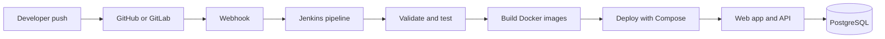

# Full-stack CI/CD with Jenkins

An assessment-ready sample that demonstrates an automated pipeline for a React frontend and Express API backed by PostgreSQL. A push to GitHub/GitLab can trigger Jenkins to lint, test, build container images, and deploy with Docker Compose.

## Architecture



## Requirements

- Docker Engine and Docker Compose plugin
- Jenkins with Docker access (the Jenkins agent must have `docker` and `docker compose`)
- GitHub or GitLab repository with webhook connectivity to Jenkins

## Run locally

```bash
cp .env.example .env
docker compose up --build
```

Open <http://localhost:8080>. The API health endpoint is <http://localhost:3000/api/health>. The demo includes a task list; tasks persist in PostgreSQL.

## Jenkins setup

1. Push this repository to GitHub or GitLab.
2. Create a Jenkins Pipeline job and point it at the repository. Set the script path to `Jenkinsfile`.
3. Install/configure the corresponding GitHub or GitLab integration (or use a Multibranch Pipeline). Configure a push webhook to the Jenkins endpoint supported by that integration. Ensure Jenkins is reachable from the SCM provider and webhook delivery succeeds.
4. Add a Jenkins credential with ID `app-db-password`, type **Secret text**, containing a strong database password. Do not commit `.env` or credentials.
5. Ensure the build agent can run Docker and Compose, and has permission to deploy the Compose project on the target host. For a separate deployment host, replace the local Compose deployment with a restricted SSH/agent deployment step and store its key in Jenkins Credentials.
6. Push a commit. Jenkins checks out the code, runs tests, builds images, then deploys. Review the console log and open the app at the configured host's port 8080.

For a classroom demo, Jenkins and the application can run on the same Docker-capable machine. Do not expose Jenkins publicly without TLS, authentication, and network restrictions.

## Pipeline stages

| Stage | Purpose |
|---|---|
| Checkout | Fetches the pushed revision |
| Validate | Checks required project files |
| Test API | Installs locked dependencies and runs Node tests |
| Build images | Builds frontend/API images tagged with the commit ID |
| Deploy | Starts or updates the Compose stack |
| Verify deployment | Polls the API health check |

## Useful commands

```bash
docker compose logs -f
docker compose down                 # stop containers; keep database volume
docker compose down -v              # remove containers and demo database data
```

## Assessment talking points

- Webhooks make the pipeline event-driven; a multibranch job can discover branches and pull requests.
- Tests run before image build and deployment, so a failing test prevents release.
- Commit-based image tags make the deployed version identifiable and support rollback by redeploying a prior tag.
- Production deployments should add a registry, image scanning, approval gates, backups, TLS, secret management, and a tested rollback strategy.

